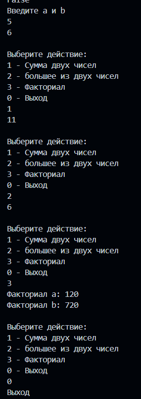
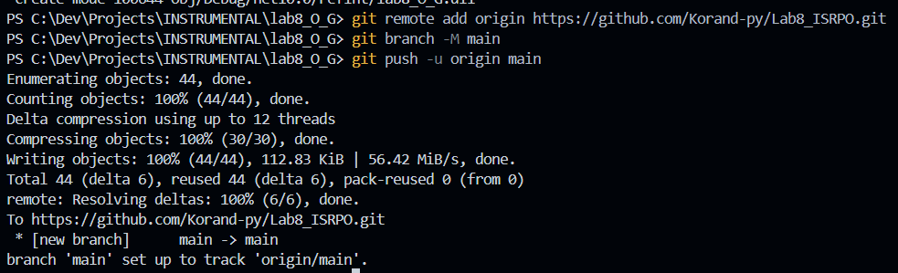

# Практическая работа №8 
**ФИО:** Окишев Максим Сергеевич  
**Группа:** ИСП-242  
**Дата:** 25.10.2026
## Что изучено 
- static void Name() - метод, который ничего не возвращает
- (int a, int b) - передача данных в метод
- Name(3, 5) - вызов метода с конкретными данными

## Скриншоты

Результат:

Git:

